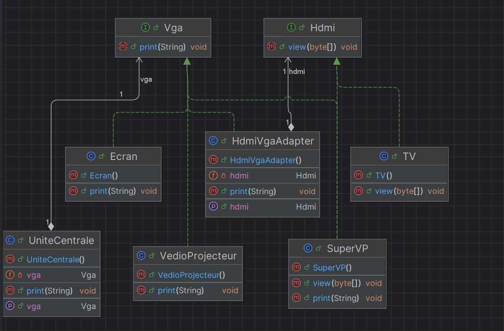

# Design Pattern Adapter en Java

Ce projet est une implémentation simple et pédagogique du **Design Pattern Adapter** (Adaptateur) en Java. Il s'inscrit dans le cadre de l'Activité Pratique N° 3 encadrée par M. Mohamed Youssfi. Il illustre comment faire collaborer des classes ayant des interfaces incompatibles en créant un pont (un adaptateur).

## Architecture du Projet

Le projet suit une structure orientée objet propre avec les composants suivants :
- **`Vga`** et **`Hdmi`** (Interfaces) : Définissent les contrats respectifs pour les flux VGA (`print(String)`) et HDMI (`view(byte[])`).
- **`Ecran`**, **`VedioProjecteur`** (Classes Concrètes) : Implémentent l'interface `Vga`.
- **`TV`**, **`SuperVP`** (Classes Concrètes) : Implémentent l'interface `Hdmi` (ou plusieurs interfaces selon l'équipement).
- **`HdmiVgaAdapter`** (Classe Adaptateur) : Implémente l'interface `Vga` tout en encapsulant une référence vers un objet de type `Hdmi` (composition/adaptation d'interface). Elle traduit l'appel `print(String)` en un appel compatible `view(byte[])`.
- **`UniteCentrale`** : La classe cliente qui manipule uniquement une interface `Vga` sans se soucier du type d'écran branché grâce à l'adaptateur.
- **`Main`** : La classe principale (`EntryPoint`) permettant de tester l'intégration et le couplage dynamique.

## Diagramme de Classes

Le diagramme ci-dessous illustre la structure des classes et des relations du projet :



## Technologies Utilisées
- **Java** (JDK 21)
- **Maven** (Gestion de projet et compilation)
- **IntelliJ IDEA** (Environnement de développement)

## Exemple d'utilisation

```java
UniteCentrale uc = new UniteCentrale();
uc.setVga(new Ecran());
uc.print("Bonjour le monde VGA !");

// Utilisation de l'adaptateur pour brancher un équipement HDMI sur une sortie VGA
HdmiVgaAdapter adapter = new HdmiVgaAdapter();
adapter.setHdmi(new TV());

uc.setVga(adapter);
uc.print("Signal converti et affiché sur l'écran HDMI !");
